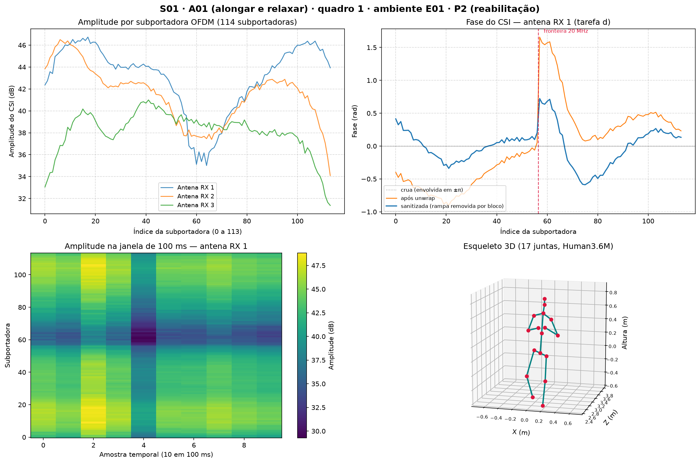

# Sensoriamento de Poses Humanas Usando Sinais WiFi

Projeto da disciplina **Ações Integradas de Ciência e Tecnologia I (AICT I)**.

## 🎯 Objetivo

Processar sinais de rádio (CSI de WiFi) e estimar movimentos corporais **sem
câmera** — a partir apenas de como o corpo humano deforma o sinal WiFi ao se
mover pelo ambiente.

> ### 📌 Trocamos de dataset em 10/09/2026
>
> O projeto começou com o [Wi-PoseDataset](https://github.com/NjtechCVLab/Wi-PoseDataset),
> mas ele só distribui **amplitude** (sem fase) e anotação **2D** — o que deixava
> as tarefas (b) e (d) do enunciado sem objeto.
>
> Agora usamos o **[MM-Fi](https://github.com/ybhbingo/MMFi_dataset)** (NeurIPS 2023),
> que tem **fase do sinal**, **pose 3D**, 114 subportadoras, 27 ações, 40 sujeitos
> e 4 ambientes. O porquê da troca está em [`docs/analise-mmfi.md`](docs/analise-mmfi.md).

## 📋 Tarefas do projeto

Conforme o `tema.pdf`:

| | Tarefa | Situação |
|---|---|---|
| **a** | Revisão bibliográfica — Wi-Pose (atividades predefinidas) × Winect (free-form) | 🔲 |
| **b** | Manipulação das estruturas de dados — carregar o CSI e plotar gráficos | 🟡 em andamento |
| **c** | Classificação de movimentos — modelo de ML para discriminar as 27 ações | 🟡 baseline RF/SVM implementado; rede neural pendente |
| **d** | Pré-processamento e calibração — filtragem espacial e temporal, offsets de fase | 🟡 sanitização de fase implementada |
| **e** | Análise crítica — matrizes de confusão, impacto de subportadoras ruidosas | 🟡 matriz de confusão do baseline |

## 🚀 Começando

**1. Ambiente**

```cmd
python -m venv .venv
.venv\Scripts\activate
pip install -r requirements.txt
```

<sub>Git Bash: `source .venv/Scripts/activate` — PowerShell: `.venv\Scripts\Activate.ps1`</sub>

**2. Apontar o dataset** (ver seção abaixo para o download)

```cmd
set MMFI_DATASET=C:\caminho\para\MMFi_Dataset
```

<sub>Git Bash: `export MMFI_DATASET=/c/caminho/para/MMFi_Dataset` — PowerShell: `$env:MMFI_DATASET="..."`</sub>

Sem a variável, o código procura em `~/Downloads/datas/MMFi_Dataset`.

**3. Conferir que está tudo funcionando**

```
.venv/Scripts/python.exe -m pytest tests/ -v
```

## 🔍 Inspecionar amostras (Tarefa b)

Carrega uma amostra, imprime a estrutura e gera os gráficos de CSI e pose 3D:

```
.venv/Scripts/python.exe scripts/inspecionar_mmfi.py
.venv/Scripts/python.exe scripts/inspecionar_mmfi.py --sujeito S18 --acao A22 --quadro 120
.venv/Scripts/python.exe scripts/inspecionar_mmfi.py --acao A12 --movimento --mostrar
```

| Opção | O que faz |
|---|---|
| `--sujeito` | `S01` a `S40` |
| `--acao` | `A01` a `A27` |
| `--quadro` | `1` a `297` |
| `--mostrar` | Abre a janela interativa (dá para girar o esqueleto 3D) |
| `--movimento` | Gera também um painel com 5 esqueletos ao longo da sequência |
| `--salvar` | Caminho do PNG (padrão: `artifacts/figuras/mmfi_amostra.png`) |

O script lê **um** arquivo de 53 KB e um `.npy` de 60 KB. Não precisa de GPU nem
carrega o dataset inteiro — roda em poucos segundos.

As figuras saem em `artifacts/figuras/`:



## 🧠 Classificar as ações (Tarefa c)

Baseline com **Random Forest** ou **SVM** sobre estatísticas do CSI em janelas de
30 quadros (3 s): média e desvio padrão por antena × subportadora, para amplitude
e fase sanitizada (1.368 atributos).

```
.venv/Scripts/python.exe scripts/treinar_baseline.py --protocolo s2 --modelo rf
.venv/Scripts/python.exe scripts/treinar_baseline.py --protocolo s1 --modelo svm --seed 1
```

| Opção | O que faz |
|---|---|
| `--protocolo` | `s2` (padrão) — cross-subject oficial: S05, S10, …, S40 só no teste. `s1` — 10 sequências de cada ação sorteadas para o teste |
| `--modelo` | `rf` (padrão) ou `svm` |
| `--acoes` | `p3` (padrão, as 27), `p1` (diárias) ou `p2` (reabilitação) |
| `--janela` / `--passo` | Quadros por janela (padrão 30) e passo (padrão = janela, sem sobreposição) |
| `--seed` | Semente do sorteio do S1, do modelo e do bootstrap (registrada no JSON) |
| `--refazer` | Reconstrói o cache do CSI |

- **Sem vazamento:** a divisão é sempre por **sequência** (sujeito, ação) — nunca
  por quadro ou janela, que poria quadros vizinhos de 100 ms dos dois lados.
- **Duas visões:** acurácia **por janela** e **por sequência** (média das
  probabilidades das janelas da sequência, 9 no padrão), com **IC 95% por bootstrap de sequências** e a
  linha do acaso (1/27 ≈ 3,7%).
- **Cache:** na primeira execução, amplitude e fase sanitizada das 1.080 sequências
  vão para `artifacts/cache/` (~9 GB em disco, lido por memmap — nunca carregado
  inteiro na RAM). As execuções seguintes o reaproveitam.
- **Saídas:** com `<sufixo>` = `<protocolo>_<modelo>[_<acoes>]_j<janela>_p<passo>_seed<seed>`
  (`_<acoes>` só fora do P3), métricas em `artifacts/resultados/baseline_<sufixo>.json`
  (não versionado) e as matrizes de confusão normalizadas em
  `artifacts/figuras/confusao_<sufixo>.png` (por janela) e
  `artifacts/figuras/confusao_<sufixo>_seq.png` (por sequência).

## 💾 Dataset — MM-Fi

[MM-Fi](https://github.com/ybhbingo/MMFi_dataset) — 1.080 sequências de 297 quadros
(320.760 no total), com CSI de WiFi 5 GHz (amplitude **e fase**, 114 subportadoras,
3 antenas) e pose **3D** de 17 juntas, para 27 ações de 40 voluntários em 4 ambientes.

Estrutura esperada:

```
MMFi_Dataset/E01..E04/S01..S40/A01..A27/
├── ground_truth.npy        pose 3D da sequência: (297, 17, 3), em metros
└── wifi-csi/frameNNN.mat   CSIamp e CSIphase, ambos (3, 114, 10)
```

Só a modalidade `wifi-csi` já são ~16 GB, então o dataset **não é versionado**.
Cada integrante baixa a própria cópia pelo
[link oficial](https://github.com/ybhbingo/MMFi_dataset#download).

⚠️ **Três armadilhas do dataset**, todas tratadas em [`src/mmfi.py`](src/mmfi.py):

- `CSIamp` está em **dB**, não em escala linear — e os `-inf` que aparecem em ~5%
  dos arquivos são `log10(0)`.
- O esqueleto é **Human3.6M**, não COCO, apesar de ambos terem 17 juntas.
- O eixo **y cresce para baixo** — plotar sem inverter desenha a pessoa de
  cabeça para baixo.

## 📖 Documentação

| Documento | Para quê |
| --- | --- |
| [`docs/resumo-do-projeto.md`](docs/resumo-do-projeto.md) | **Visão geral rápida:** objetivo, o que o professor pede, o que já foi feito, resultados e próximos passos. |
| [`docs/analise-mmfi.md`](docs/analise-mmfi.md) | **Comece por aqui.** O que o MM-Fi entrega, riscos metodológicos e caminhos possíveis. |
| [`docs/replicar-mmfi.md`](docs/replicar-mmfi.md) | Como replicar o baseline publicado, e o que já vem pronto no toolbox oficial. |
| [`docs/guia-do-projeto.md`](docs/guia-do-projeto.md) | Explicação do projeto do zero, sem pressupor conhecimento prévio (escrito na fase Wi-Pose). |
| [`docs/analise-inicial.md`](docs/analise-inicial.md) | Análise do Wi-Pose — documenta por que trocamos de dataset. |

## 📚 Artigos de Referência

- **MM-Fi:** Yang, J., et al. *"MM-Fi: Multi-Modal Non-Intrusive 4D Human Dataset for Versatile Wireless Sensing."* NeurIPS 2023 — **o dataset que usamos**.
- **Wi-Pose:** Jiang, W., et al. *"Towards 3D human pose construction using WiFi."* MobiCom, 2020.
- **Winect:** Ren, Y., et al. *"Winect: 3D Human Pose Tracking for Free-form Activity Using Commodity WiFi."* IMWUT, 2021.
- **MetaFi++:** Zhou, Y., et al. *"WiFi-Enabled Transformer-Based Human Pose Estimation."* IEEE IoT Journal, 2023 — baseline de WiFi do MM-Fi.

## 🗂️ Estrutura

```
AICT-I-WiPose/
├── Artigos/                     Artigos de referência em PDF
├── artifacts/figuras/           Figuras geradas (versionadas)
├── docs/                        Análises e documentação
├── scripts/
│   ├── inspecionar_mmfi.py      Inspeção de amostra do MM-Fi
│   └── treinar_baseline.py      Baseline de classificação das ações (Tarefa c)
├── src/
│   ├── mmfi.py                  Carregamento do MM-Fi
│   ├── protocolos.py            Splits S1/S2 por sequência, sem vazamento
│   ├── cache_csi.py             Cache em disco do CSI (memmap)
│   ├── atributos.py             Janelas de quadros e atributos estatísticos
│   ├── avaliacao.py             Acurácia, IC bootstrap e matriz de confusão
│   └── visualizacao_mmfi.py     Gráficos de CSI e esqueleto 3D
├── tests/                       Testes (os que precisam do dataset pulam sem ele)
├── tema.pdf                     Proposta da disciplina
└── requirements.txt
```

<details>
<summary>Arquivos da primeira fase (dataset Wi-Pose, abandonado)</summary>

Mantidos como registro, mas **não fazem parte do fluxo atual**:

```
dataset/                   Onde ficava o Wi-Pose (ver dataset/README.md)
scripts/inspecionar.py     Inspeção de amostra do Wi-Pose
src/dados.py               Carregamento do Wi-Pose
src/visualizacao.py        Gráficos de CSI e esqueleto 2D
docs/inspecao_amostra.png  Figura gerada na primeira fase
```

Eles dependem do dataset Wi-Pose, que não está mais em uso.

</details>
