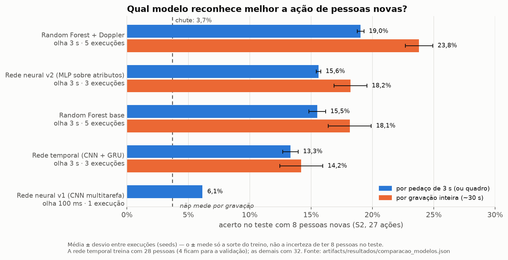
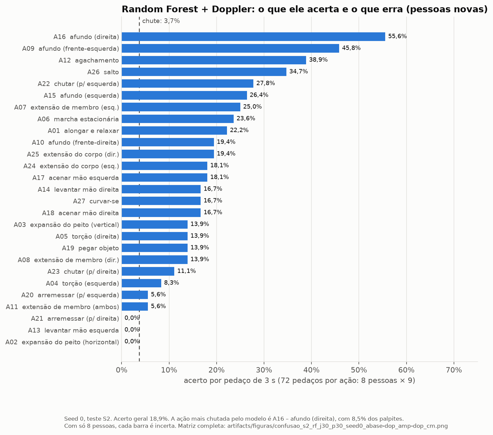
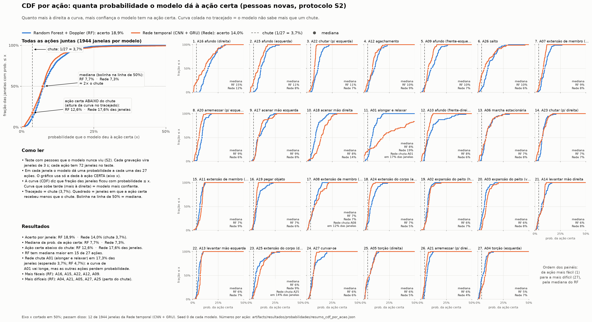
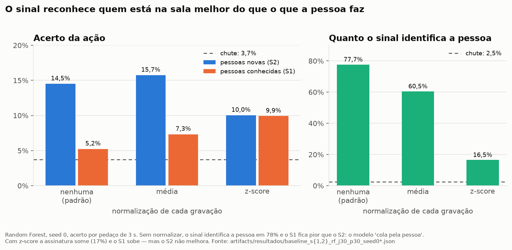
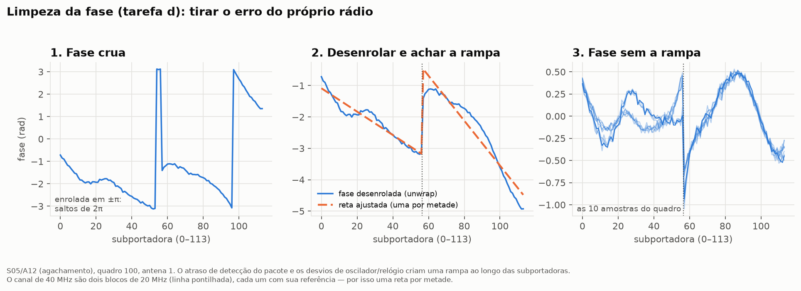
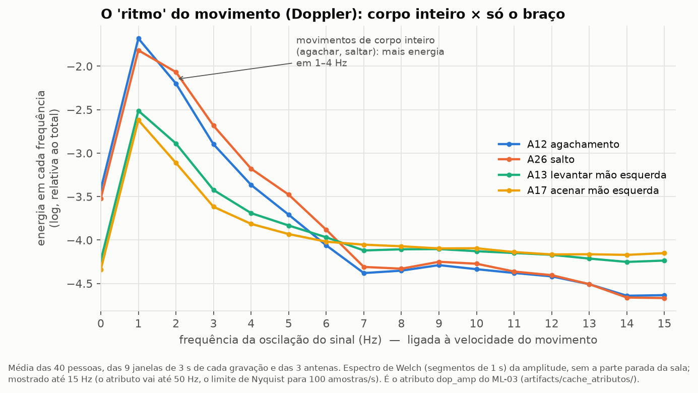

# Sensoriamento de Poses Humanas Usando Sinais WiFi

Projeto da disciplina **Ações Integradas de Ciência e Tecnologia I (AICT I)**  
**Universidade Federal do Ceará (UFC)** — Departamento de Engenharia de Teleinformática (DETI)

## 🎯 Objetivo

Processar sinais de rádio (CSI de WiFi a 5 GHz no padrão IEEE 802.11n) e inferir movimentos corporais e poses humanas **sem câmeras e sem sensores vestíveis**, a partir exclusivamente da modulação por múltiplos percursos (*multipath fading*) e efeito Doppler causados pelo corpo humano no canal de propagação.

> ### 📌 Dataset Adotado: MM-Fi (NeurIPS 2023)
>
> O projeto migrou do antigo *Wi-Pose* para o **[MM-Fi](https://github.com/ybhbingo/MMFi_dataset)** (NeurIPS 2023) porque o Wi-Pose distribuía apenas amplitude sem fase e poses 2D.
> O MM-Fi entrega **fase do sinal envolvida em $\pm\pi$**, **pose 3D real em metros** (17 articulações no padrão Human3.6M), 114 subportadoras OFDM, 27 ações corporais (14 diárias e 13 de reabilitação), 40 voluntários identificados e 4 ambientes físicos. A fundamentação técnica da troca está documentada em [`docs/analise-mmfi.md`](docs/analise-mmfi.md).

---

## 📋 Status das Tarefas do Enunciado (`tema.pdf`)

| | Tarefa | Situação | Entregável / Código |
|---|---|---|---|
| **a** | Revisão bibliográfica — Wi-Pose (atividades predefinidas) × Winect (free-form) | ✅ Concluída | [`docs/analise-mmfi.md`](docs/analise-mmfi.md) e [`docs/guia-do-projeto.md`](docs/guia-do-projeto.md) |
| **b** | Manipulação das estruturas de dados — carregar o CSI e plotar gráficos | ✅ Concluída | [`src/mmfi.py`](src/mmfi.py), [`scripts/inspecionar_mmfi.py`](scripts/inspecionar_mmfi.py) e versão leve em `dataset/MMFi_leve` |
| **c** | Classificação de movimentos — modelos de ML e Deep Learning | ✅ Concluída | Baseline RF/SVM ([`scripts/treinar_baseline.py`](scripts/treinar_baseline.py)), rede temporal ([`scripts/treinar_rede_temporal.py`](scripts/treinar_rede_temporal.py)) e Rede Neural Multi-Head ([`src/rede_neural.py`](src/rede_neural.py), [`scripts/treinar_rede.py`](scripts/treinar_rede.py)) |
| **d** | Pré-processamento e calibração — filtragem espacial/temporal e offsets de fase | ✅ Concluída | Sanitização de fase por regressão linear em [`src/mmfi.py`](src/mmfi.py) e normalização min-max |
| **e** | Análise crítica — matrizes de confusão e impacto de subportadoras ruidosas | 🟡 Em andamento | Matrizes de confusão, acerto por ação e CDF por ação em [`artifacts/figuras/`](artifacts/figuras/); a ablação de subportadoras da v1 não vale como análise (ver abaixo) |

---

## 🔬 Modelagem Preditiva: Do Baseline Clássico à Rede Neural Multi-Head

O projeto implementou duas abordagens complementares de aprendizado de máquina para resolver a Tarefa (c):

### 1. Baselines Clássicos de Machine Learning (RF e SVM)
* **Arquivos:** [`scripts/treinar_baseline.py`](scripts/treinar_baseline.py), [`src/atributos.py`](src/atributos.py), [`src/avaliacao.py`](src/avaliacao.py).
* **Método:** Corta cada sequência em janelas de 3 s (30 quadros) e extrai **média e desvio padrão** por antena × subportadora, da amplitude e da fase sanitizada (1.368 atributos); treina **Random Forest** ou **SVM**. A divisão treino/teste é sempre por sequência inteira (S2 oficial ou S1 agrupado), sem vazamento.
* **Normalização por sequência (ML-02, experimento):** `--normalizacao nenhuma|media|zscore` e `--diagnostico-sujeito` (mede quanto os atributos identificam a pessoa). Resultado e leitura em [`docs/resumo-do-projeto.md`](docs/resumo-do-projeto.md).
* **Atributos de Doppler e entre antenas (ML-03):** `--atributos base,antenas,dop_amp,dop_cm` (lista separada por vírgula, concatenada nessa ordem; padrão `base`, que reproduz o ML-01/02). Os conjuntos novos ([`src/doppler.py`](src/doppler.py)) ficam num cache próprio em `artifacts/cache_atributos/` (~6 min medidos na primeira vez). [`scripts/selecionar_atributos.py`](scripts/selecionar_atributos.py) (só Random Forest, só S2/P3) escolhe a combinação por **validação** (sujeitos S04, S14, S24, S34 retirados do treino, 3 seeds) e só depois avalia o teste S2 com 5 seeds, com comparação pareada contra o `base`; resultado em `artifacts/resultados/selecao_atributos.json` e no resumo do projeto.
* **Resultados e Métricas:** Salvos em `artifacts/resultados/baseline_*.json` com intervalos de confiança por bootstrap e matrizes de confusão em `artifacts/figuras/confusao_*.png`.

### 2. Rede Neural Convolucional Multi-Head (Deep Learning)
* **Arquivos:** [`src/rede_neural.py`](src/rede_neural.py), [`src/dataset_rede.py`](src/dataset_rede.py), [`scripts/treinar_rede.py`](scripts/treinar_rede.py).
* **Arquitetura `CSISpatialSpectralTemporalNet`:**
  * **Entrada:** Tensor CSI tridimensional `(Batch, C=3, 114 subportadoras, 10 amostras temporais)`.
  * **Backbone Convolucional Residual:** Três blocos com *Batch Normalization*, compressão no domínio espectral ($114 \rightarrow 57 \rightarrow 28 \rightarrow 14$) e temporal ($10 \rightarrow 5$), gerando um vetor latente de 256 características via *Adaptive Average Pooling 2D*.
  * **Cabeça 1 (Classificação — Tarefas c e e):** 27 ações corporais via *Cross-Entropy Loss*.
  * **Cabeça 2 (Pose 3D — Rota B):** Regride coordenadas métricas $(x, y, z)$ das 17 articulações em metros via *MSE Loss*, com prior anatômico inicializado no centro da cena ($Z \approx 3{,}0\text{ m}$).
  * **Função de Perda Conjunta:** $\mathcal{L}_{\text{total}} = \mathcal{L}_{\text{cls}} + 10{,}0 \cdot \mathcal{L}_{\text{pose}}$.

### 3. Rede temporal própria e comparação dos modelos (ML-04)
* **Arquivos:** [`src/rede_temporal.py`](src/rede_temporal.py), [`scripts/treinar_rede_temporal.py`](scripts/treinar_rede_temporal.py), [`scripts/rodar_rede_neural.py`](scripts/rodar_rede_neural.py), [`scripts/comparar_modelos.py`](scripts/comparar_modelos.py).
* **Rede temporal:** janelas de 3 s (30 quadros); cada quadro vira `(60 canais = amplitude e fase × 3 antenas × 10 amostras, 114 subportadoras)`, com a média da própria sequência subtraída e padronização pelo treino. Codificador `Conv1d` por quadro + GRU bidirecional sobre os 30 quadros (~286 mil parâmetros, ~45 s/época em CPU). A época é escolhida na **validação** (S04, S14, S24, S34 retirados do treino) e o teste S2 é avaliado uma vez.
* **Redes neurais v1 e v2:** `rodar_rede_neural.py` roda as duas versões (`main` 98a1f49 e `rede-neural-sml` 68d96a9) **sem alterar o código**, em `git worktree` temporários fora do repositório, 3 execuções cada, e copia os JSON para `artifacts/resultados/rede_neural_v<1|2>_exec<i>.json`.
* **Comparação:** `comparar_modelos.py` junta RF base, RF + Doppler, rede temporal e as duas versões da rede neural (v1 e v2) numa tabela (média ± desvio entre execuções, unidade de cada modelo, como o número é escolhido) em `artifacts/resultados/comparacao_modelos.json`; tabela e leitura no [resumo do projeto](docs/resumo-do-projeto.md).
* **Cuidados na leitura:** o "±" é só a variação entre seeds; os ICs por execução (só nos JSON do RF e da rede temporal) ignoram que as gravações se agrupam por pessoa (8 no teste) e são otimistas; só RF + Doppler × RF base foi comparado de forma pareada (ML-03). A rede temporal treina com 28 pessoas (4 ficam para a validação, sem retreino); os outros modelos, com 32. Ela também subtrai a média da gravação inteira antes de cortar as janelas, então o número "por janela" dela usa contexto do resto da gravação.
* **Rede v1 reexecutada no ML-04:** 6,1% por quadro na última época (melhor época 6,4%), 1 execução. Os 5,74% (pico 6,11%) citados no relatório da v1 são de uma execução anterior; o script não tem seed, então as duas não são reproduzíveis entre si.
* **CDF por ação:** `treinar_baseline.py` e `treinar_rede_temporal.py` gravam, ao lado do JSON, a probabilidade de cada ação em cada janela do teste (`probabilidades_*.npz`, ver `src/avaliacao.salvar_probabilidades`). `gerar_figuras_resultados.py --apenas-cdf` lê as de `artifacts/resultados/probabilidades/` e desenha a CDF da probabilidade dada à ação certa, um painel por ação.

---

## 📈 Resultados em gráficos (teste com pessoas novas, S2)

| Comparação dos modelos | Acerto por ação do melhor modelo |
|:---:|:---:|
|  |  |
| *RF + Doppler 19,0% por pedaço de 3 s / 23,8% por gravação (chute: 3,7%)* | *Ações de corpo inteiro (afundo, agachamento, salto) são as mais fáceis* |

**CDF por ação** — quanta probabilidade cada modelo dá à ação certa, um painel por ação (leitura no [resumo do projeto](docs/resumo-do-projeto.md)):



| O sinal identifica a pessoa | Limpeza da fase (tarefa d) | Doppler: o "ritmo" do movimento |
|:---:|:---:|:---:|
|  |  |  |

Explicação completa no [resumo do projeto](docs/resumo-do-projeto.md). Para regerar: `python scripts/gerar_figuras_resultados.py`.

---

## 🗄️ Rede neural v1 (multi-head): resultados anteriores

As tabelas da v1 (5,74% de acurácia, MPJPE 243 mm, ablação de subportadoras) saíram do README porque não se comparam com os modelos acima:

* **Acurácia:** a v1 olha um quadro de 100 ms e fica em ~6%, abaixo do Random Forest (15–19%). Os 5,45% (AGCN) do artigo do MM-Fi reconhecem a ação a partir do *esqueleto estimado*, outro pipeline; não são um baseline da classificação direta.
* **Escolha da época:** o teste era medido a cada época e a "melhor época" (6,11% / 241,9 mm) foi escolhida olhando o teste. Não havia validação.
* **Ablação:** as subportadoras eram zeradas só no teste, numa rede treinada com as 114. A queda mede a rede recebendo uma entrada que nunca viu, não a informação de cada faixa do espectro.

O código, o relatório ([`docs/relatorio_rede_neural.md`](docs/relatorio_rede_neural.md)) e as figuras (`artifacts/figuras/matriz_confusao.png`, `ablacao_subportadoras.png`, `pose3d_predicao.png`) continuam no repositório. A v1 entra na comparação acima com 6,1%.

---

## 🚀 Como Começar e Reproduzir

### 1. Ambiente Virtual e Dependências

```powershell
python -m venv .venv
.venv\Scripts\activate
pip install -r requirements.txt
```

### 2. Executar a Suíte de Testes Automatizados

```powershell
python -m pytest tests/ -v
```

### 3. Executar o Treinamento da Rede Neural Multi-Head

```powershell
python scripts/treinar_rede.py --split S2 --protocolo P3 --epocas 15 --batch-size 32 --stride 20
```

### 4. Executar os Baselines Clássicos (Random Forest e SVM)

```powershell
python scripts/treinar_baseline.py --protocolo s2 --modelo rf
python scripts/treinar_baseline.py --protocolo s2 --modelo rf --normalizacao zscore --diagnostico-sujeito
python scripts/treinar_baseline.py --protocolo s2 --modelo rf --atributos base,dop_amp,dop_cm
python scripts/selecionar_atributos.py
```

### 5. Rede Temporal Própria e Comparação dos Modelos (ML-04)

```powershell
python scripts/treinar_rede_temporal.py --seed 0 1 2
python scripts/rodar_rede_neural.py
python scripts/comparar_modelos.py
```

CDF por ação (seed 0 de cada modelo, gravada numa pasta separada para não sobrescrever os resultados versionados):

```powershell
python scripts/treinar_baseline.py --protocolo s2 --modelo rf --atributos base,dop_amp,dop_cm --resultados artifacts/resultados/probabilidades --figuras artifacts/resultados/probabilidades/figuras
python scripts/treinar_rede_temporal.py --seed 0 --resultados artifacts/resultados/probabilidades --figuras artifacts/resultados/probabilidades/figuras
python scripts/gerar_figuras_resultados.py --apenas-cdf
```

A rede temporal carrega ~4,4 GB em RAM (~45 s); com a CPU dividida entre os treinos, foram medidos 43–45 min por seed. `rodar_rede_neural.py` roda 3 execuções de cada versão (`--versoes`, `--execucoes` para reduzir) e só escreve em `artifacts/resultados/`; medidos aqui, com a CPU dividida: v2 5–12 min por execução (incluindo ~3 min de cache na primeira) e v1 ~107 min (a seção da rede neural cita ~16 min sozinha, não medido aqui). No ML-04 a v1 rodou 1 vez, por tempo.

### 6. Inspecionar Amostras Individuais do MM-Fi (Tarefa b)

```powershell
python scripts/inspecionar_mmfi.py --sujeito S18 --acao A22 --quadro 120
python scripts/inspecionar_mmfi.py --acao A12 --movimento
```

---

## 📖 Documentação Acadêmica Disponível

| Documento | Descrição |
|---|---|
| [`docs/guia_apresentacao_professor.md`](docs/guia_apresentacao_professor.md) | **Roteiro completo de apresentação para o professor**, com pitch cronometrado (5-8 min), explicação de cada figura e guia de defesa contra perguntas difíceis (Q&A). |
| [`docs/contexto_antigravity.md`](docs/contexto_antigravity.md) | **Documento de passagem de bastão (Handover)** para instâncias do Antigravity ou novos pesquisadores continuarem o trabalho em outra máquina. |
| [`docs/relatorio_rede_neural.md`](docs/relatorio_rede_neural.md) | **Relatório técnico completo em Markdown**, detalhando formulação de RF, equações de canal, arquitetura e análise das matrizes de confusão. |
| [`docs/relatorio_rede_neural.tex`](docs/relatorio_rede_neural.tex) | **Artigo científico formal em LaTeX** formatado em duas colunas (padrão IEEE / SBrT), com equações, tabelas e citações, pronto para compilação em PDF. |
| [`docs/resumo-do-projeto.md`](docs/resumo-do-projeto.md) | Visão geral rápida dos requisitos da disciplina e histórico do projeto. |
| [`docs/analise-mmfi.md`](docs/analise-mmfi.md) | Análise aprofundada do dataset MM-Fi e justificativa metodológica da migração. |
| [`docs/replicar-mmfi.md`](docs/replicar-mmfi.md) | Estudo comparativo contra os baselines oficiais publicados. |

---

## 🗂️ Estrutura do Repositório

```
AICT-I-WiPose/
├── artifacts/
│   ├── figuras/                     Figuras científicas versionadas (PNG)
│   │   ├── matriz_confusao.png      Matriz de confusão da Rede Neural (27 ações)
│   │   ├── ablacao_subportadoras.png Gráfico de impacto espectral OFDM
│   │   ├── pose3d_predicao.png      Esqueleto 3D real vs estimado
│   │   └── confusao_s*.png          Matrizes de confusão dos baselines RF/SVM
│   ├── resultados/                  Métricas em JSON dos baselines RF e SVM
│   │   └── probabilidades/          Probabilidades por janela do teste (.npz) e resumo da CDF por ação
│   └── resultados_rede_neural.json  Métricas e histórico numérico da Rede Neural
├── docs/
│   ├── guia_apresentacao_professor.md Roteiro falado e guia de defesa para o professor
│   ├── contexto_antigravity.md      Handover técnico para nova máquina / Antigravity
│   ├── relatorio_rede_neural.md     Relatório técnico da rede neural
│   ├── relatorio_rede_neural.tex    Artigo formal em LaTeX
│   └── resumo-do-projeto.md         Resumo executivo do projeto
├── scripts/
│   ├── treinar_rede.py              Pipeline de treino e ablação da Rede Neural
│   ├── treinar_baseline.py          Treino dos baselines clássicos (RF e SVM)
│   ├── selecionar_atributos.py      Escolha dos atributos por validação (ML-03)
│   ├── treinar_rede_temporal.py     Treino da rede temporal própria (ML-04)
│   ├── gerar_figuras_resultados.py  Gráficos de resultados (comparação, assinatura, por ação, CDF por ação, fase, Doppler)
│   ├── rodar_rede_neural.py        Roda as redes neurais v1 e v2 em worktrees (ML-04)
│   ├── comparar_modelos.py          Tabela de comparação dos modelos no S2 (ML-04)
│   ├── inspecionar_mmfi.py          Inspeção e plot de amostras CSI/3D
│   └── empacotar_mmfi.py            Conversor de dados para versão leve (.npz)
├── src/
│   ├── rede_neural.py               Arquitetura CSISpatialSpectralTemporalNet
│   ├── dataset_rede.py              Dataloader PyTorch vetorizado em RAM
│   ├── atributos.py                 Extração de atributos estatísticos (ML clássico)
│   ├── doppler.py                   Atributos de Doppler e entre antenas + cache (ML-03)
│   ├── rede_temporal.py             Rede temporal própria: Conv1d por quadro + GRU (ML-04)
│   ├── avaliacao.py                 Acurácia e IC bootstrap (ML clássico)
│   ├── cache_csi.py                 Cache em disco de tensores CSI
│   ├── protocolos.py                Splits oficiais S1 e S2
│   ├── mmfi.py                      Carregamento do MM-Fi e sanitização de fase
│   └── visualizacao_mmfi.py         Visualização 3D de poses e CSI
├── tests/
│   ├── test_rede_neural.py          Testes da rede neural e métricas
│   ├── test_ml01.py                 Testes dos baselines clássicos
│   ├── test_cdf.py                  Testes das probabilidades gravadas e da CDF por ação
│   └── test_mmfi.py                 Testes do dataset e sanitização
├── tema.pdf                         Enunciado oficial da disciplina
└── requirements.txt                 Dependências do projeto
```
