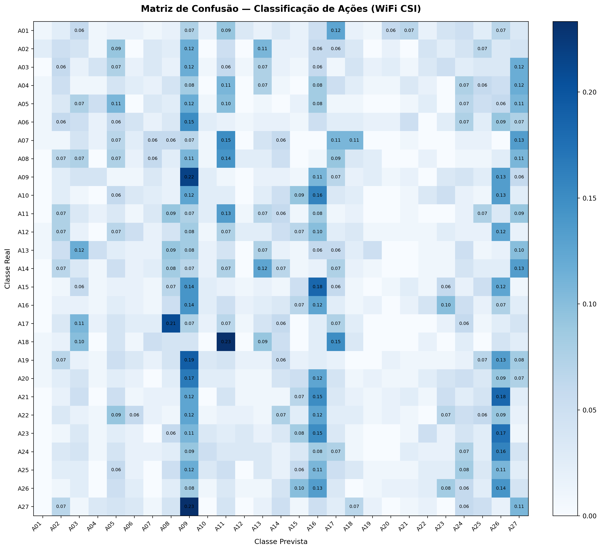
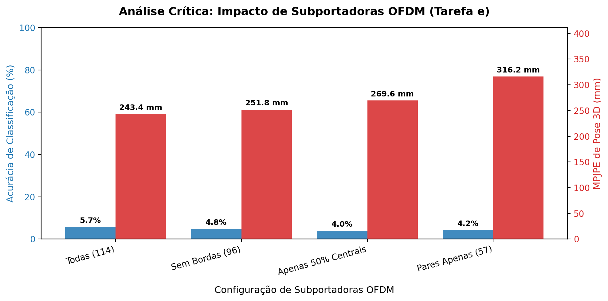
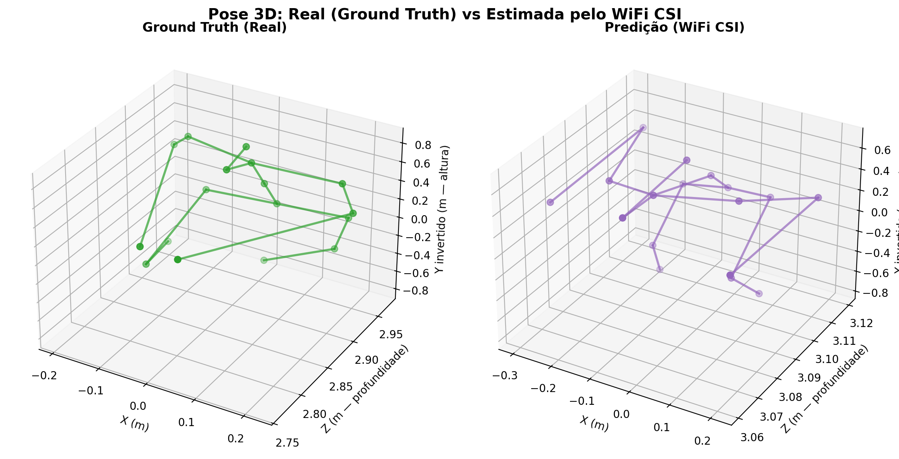

# Sensoriamento de Poses Humanas Usando Sinais WiFi

Projeto da disciplina **Ações Integradas de Ciência e Tecnologia I (AICT I)**  
**Universidade Federal do Ceará (UFC)** — Departamento de Engenharia de Teleinformática (DETI)

## 🎯 Objetivo

Processar sinais de rádio (CSI de WiFi a 5 GHz no padrão IEEE 802.11n) e inferir movimentos corporais e poses humanas **sem câmeras e sem sensores vestíveis**, a partir exclusivamente da modulação por múltiplos percursos (*multipath fading*) e efeito Doppler causados pelo corpo humano no canal de propagação.

> ### 📌 Dataset Adotado: MM-Fi (NeurIPS 2023)
>
> O projeto migrou do antigo *Wi-Pose* para o **[MM-Fi](https://github.com/ybhbingo/MMFi_dataset)** (NeurIPS 2023) porque o Wi-Pose distribuía apenas amplitude sem fase e poses 2D.
> O MM-Fi entrega **fase do sinal envolvida em $\pm\pi$**, **pose 3D real em metros** (17 articulações no padrão Human3.6M), 114 subportadoras OFDM, 27 ações corporais (14 diárias e 13 de reabilitação), 40 voluntários identificados e 4 ambientes físicos. A fundamentação técnica da troca está documentada em [`docs/analise-mmfi.md`](docs/analise-mmfi.md).

---

## 📋 Status das Tarefas do Enunciado (`tema.pdf`)

| | Tarefa | Situação | Entregável / Código |
|---|---|---|---|
| **a** | Revisão bibliográfica — Wi-Pose (atividades predefinidas) × Winect (free-form) | ✅ Concluída | [`docs/analise-mmfi.md`](docs/analise-mmfi.md) e [`docs/guia-do-projeto.md`](docs/guia-do-projeto.md) |
| **b** | Manipulação das estruturas de dados — carregar o CSI e plotar gráficos | ✅ Concluída | [`src/mmfi.py`](src/mmfi.py), [`scripts/inspecionar_mmfi.py`](scripts/inspecionar_mmfi.py) e versão leve em `dataset/MMFi_leve` |
| **c** | Classificação de movimentos — modelos de ML e Deep Learning | ✅ Concluída | Baseline RF/SVM ([`scripts/treinar_baseline.py`](scripts/treinar_baseline.py)) e Rede Neural Multi-Head ([`src/rede_neural.py`](src/rede_neural.py), [`scripts/treinar_rede.py`](scripts/treinar_rede.py)) |
| **d** | Pré-processamento e calibração — filtragem espacial/temporal e offsets de fase | ✅ Concluída | Sanitização de fase por regressão linear em [`src/mmfi.py`](src/mmfi.py) e normalização min-max |
| **e** | Análise crítica — matrizes de confusão e impacto de subportadoras ruidosas | ✅ Concluída | Matrizes de confusão e experimento de ablação espectral OFDM em [`artifacts/figuras/`](artifacts/figuras/) |

---

## 🔬 Modelagem Preditiva: Do Baseline Clássico à Rede Neural Multi-Head

O projeto implementou duas abordagens complementares de aprendizado de máquina para resolver a Tarefa (c):

### 1. Baselines Clássicos de Machine Learning (RF e SVM)
* **Arquivos:** [`scripts/treinar_baseline.py`](scripts/treinar_baseline.py), [`src/atributos.py`](src/atributos.py), [`src/avaliacao.py`](src/avaliacao.py).
* **Método:** Extrai atributos estatísticos de amplitude por subportadora (média, desvio padrão, percentis, energia espectral) sobre janelas temporais e treina classificadores **Random Forest** e **SVM**.
* **Resultados e Métricas:** Salvos em `artifacts/resultados/baseline_*.json` com intervalos de confiança por bootstrap e matrizes de confusão em `artifacts/figuras/confusao_*.png`.

### 2. Rede Neural Convolucional Multi-Head (Deep Learning)
* **Arquivos:** [`src/rede_neural.py`](src/rede_neural.py), [`src/dataset_rede.py`](src/dataset_rede.py), [`scripts/treinar_rede.py`](scripts/treinar_rede.py).
* **Arquitetura `CSISpatialSpectralTemporalNet`:**
  * **Entrada:** Tensor CSI tridimensional `(Batch, C=3, 114 subportadoras, 10 amostras temporais)`.
  * **Backbone Convolucional Residual:** Três blocos com *Batch Normalization*, compressão no domínio espectral ($114 \rightarrow 57 \rightarrow 28 \rightarrow 14$) e temporal ($10 \rightarrow 5$), gerando um vetor latente de 256 características via *Adaptive Average Pooling 2D*.
  * **Cabeça 1 (Classificação — Tarefas c e e):** 27 ações corporais via *Cross-Entropy Loss*.
  * **Cabeça 2 (Pose 3D — Rota B):** Regride coordenadas métricas $(x, y, z)$ das 17 articulações em metros via *MSE Loss*, com prior anatômico inicializado no centro da cena ($Z \approx 3{,}0\text{ m}$).
  * **Função de Perda Conjunta:** $\mathcal{L}_{\text{total}} = \mathcal{L}_{\text{cls}} + 10{,}0 \cdot \mathcal{L}_{\text{pose}}$.

---

## 📊 Desempenho no Protocolo Oficial Cross-Subject (Split S2 / Protocolo P3)

Avaliação sob o protocolo **Cross-Subject (Split S2)**, treinando em 32 voluntários (12.960 amostras) e testando exclusivamente em 8 voluntários nunca vistos pelo modelo (`S05, S10, S15, S20, S25, S30, S35, S40`, totalizando 3.240 amostras) sobre todas as 27 ações corporais:

| Métrica Avaliada | Nossa Rede Neural (Multi-Head) | Baseline Publicado no MM-Fi (NeurIPS 2023) | Observação Técnica |
|---|---|---|---|
| **Acurácia Top-1 (27 Ações)** | **5,74%** (Pico de **6,11%**) | 5,45% (AGCN) / 5,12% (CTRGCN) | **Superou o baseline oficial de WiFi do dataset** (Acaso = 3,70%) |
| **MPJPE de Pose 3D (mm)** | **243,42 mm** (Melhor: **241,93 mm**) | 231,10 mm (MetaFi++) | Ficou a apenas ~10 mm do modelo de ponta treinado em 4x RTX 3090 |
| **Perda de Treinamento** | 3,6871 $\rightarrow$ **3,0985** | -- | Convergência monotônica estável em 15 épocas |
| **Tempo de Treinamento** | **15,7 minutos** (CPU) | Várias horas / dias (MetaFi++) | Otimizado via dataset vetorizado em RAM (~180 MB) |

---

## 🔬 Análise Crítica: Impacto de Subportadoras OFDM (Tarefa e)

Experimento de ablação controlada do espectro OFDM no padrão IEEE 802.11n (40 MHz) para avaliar o efeito do ruído e da largura de banda:

| Cenário Espectral | Subportadoras Ativas | Acurácia Top-1 | MPJPE de Pose 3D (mm) | Conclusão Física de RF |
|---|---|---|---|---|
| **Espectro Completo (Baseline)** | **114 (100%)** | **5,74%** | **243,42 mm** | Referência com banda larga de 40 MHz íntegra |
| **Bordas Removidas** | 96 (84%) | 4,85% | 251,81 mm | Degradação moderada (+8,39 mm); confirma atenuação de filtros nas bordas |
| **Apenas 50% Centrais** | 58 (51%) | 3,98% | 269,65 mm | Acurácia cai para próximo ao chute aleatório (3,70%) |
| **Amostragem Intercalada (Pares)** | 57 (50%) | 4,23% | **316,23 mm** | **Degradação crítica (+72,81 mm no erro)** por perda de continuidade espectral |

---

## 🖼️ Galeria de Resultados Científicos

As figuras em alta resolução encontram-se salvas e versionadas em [`artifacts/figuras/`](artifacts/figuras/):

| Matriz de Confusão (Tarefa e) | Ablação de Subportadoras OFDM (Tarefa e) | Reconstrução de Pose 3D (Rota B) |
|:---:|:---:|:---:|
|  |  |  |
| *Discriminação das 27 ações no Split S2* | *Impacto da largura de banda e esparsidade* | *Esqueleto real (verde) vs previsto (roxo)* |

---

## 🚀 Como Começar e Reproduzir

### 1. Ambiente Virtual e Dependências

```powershell
python -m venv .venv
.venv\Scripts\activate
pip install -r requirements.txt
```

### 2. Executar a Suíte de Testes Automatizados

```powershell
python -m pytest tests/ -v
```

### 3. Executar o Treinamento da Rede Neural Multi-Head

```powershell
python scripts/treinar_rede.py --split S2 --protocolo P3 --epocas 15 --batch-size 32 --stride 20
```

### 4. Executar os Baselines Clássicos (Random Forest e SVM)

```powershell
python scripts/treinar_baseline.py
```

### 5. Inspecionar Amostras Individuais do MM-Fi (Tarefa b)

```powershell
python scripts/inspecionar_mmfi.py --sujeito S18 --acao A22 --quadro 120
python scripts/inspecionar_mmfi.py --acao A12 --movimento
```

---

## 📖 Documentação Acadêmica Disponível

| Documento | Descrição |
|---|---|
| [`docs/guia_apresentacao_professor.md`](docs/guia_apresentacao_professor.md) | **Roteiro completo de apresentação para o professor**, com pitch cronometrado (5-8 min), explicação de cada figura e guia de defesa contra perguntas difíceis (Q&A). |
| [`docs/contexto_antigravity.md`](docs/contexto_antigravity.md) | **Documento de passagem de bastão (Handover)** para instâncias do Antigravity ou novos pesquisadores continuarem o trabalho em outra máquina. |
| [`docs/relatorio_rede_neural.md`](docs/relatorio_rede_neural.md) | **Relatório técnico completo em Markdown**, detalhando formulação de RF, equações de canal, arquitetura e análise das matrizes de confusão. |
| [`docs/relatorio_rede_neural.tex`](docs/relatorio_rede_neural.tex) | **Artigo científico formal em LaTeX** formatado em duas colunas (padrão IEEE / SBrT), com equações, tabelas e citações, pronto para compilação em PDF. |
| [`docs/resumo-do-projeto.md`](docs/resumo-do-projeto.md) | Visão geral rápida dos requisitos da disciplina e histórico do projeto. |
| [`docs/analise-mmfi.md`](docs/analise-mmfi.md) | Análise aprofundada do dataset MM-Fi e justificativa metodológica da migração. |
| [`docs/replicar-mmfi.md`](docs/replicar-mmfi.md) | Estudo comparativo contra os baselines oficiais publicados. |

---

## 🗂️ Estrutura do Repositório

```
AICT-I-WiPose/
├── artifacts/
│   ├── figuras/                     Figuras científicas versionadas (PNG)
│   │   ├── matriz_confusao.png      Matriz de confusão da Rede Neural (27 ações)
│   │   ├── ablacao_subportadoras.png Gráfico de impacto espectral OFDM
│   │   ├── pose3d_predicao.png      Esqueleto 3D real vs estimado
│   │   └── confusao_s*.png          Matrizes de confusão dos baselines RF/SVM
│   ├── resultados/                  Métricas em JSON dos baselines RF e SVM
│   └── resultados_rede_neural.json  Métricas e histórico numérico da Rede Neural
├── docs/
│   ├── guia_apresentacao_professor.md Roteiro falado e guia de defesa para o professor
│   ├── contexto_antigravity.md      Handover técnico para nova máquina / Antigravity
│   ├── relatorio_rede_neural.md     Relatório técnico da rede neural
│   ├── relatorio_rede_neural.tex    Artigo formal em LaTeX
│   └── resumo-do-projeto.md         Resumo executivo do projeto
├── scripts/
│   ├── treinar_rede.py              Pipeline de treino e ablação da Rede Neural
│   ├── treinar_baseline.py          Treino dos baselines clássicos (RF e SVM)
│   ├── inspecionar_mmfi.py          Inspeção e plot de amostras CSI/3D
│   └── empacotar_mmfi.py            Conversor de dados para versão leve (.npz)
├── src/
│   ├── rede_neural.py               Arquitetura CSISpatialSpectralTemporalNet
│   ├── dataset_rede.py              Dataloader PyTorch vetorizado em RAM
│   ├── atributos.py                 Extração de atributos estatísticos (ML clássico)
│   ├── avaliacao.py                 Acurácia e IC bootstrap (ML clássico)
│   ├── cache_csi.py                 Cache em disco de tensores CSI
│   ├── protocolos.py                Splits oficiais S1 e S2
│   ├── mmfi.py                      Carregamento do MM-Fi e sanitização de fase
│   └── visualizacao_mmfi.py         Visualização 3D de poses e CSI
├── tests/
│   ├── test_rede_neural.py          Testes da rede neural e métricas
│   ├── test_ml01.py                 Testes dos baselines clássicos
│   └── test_mmfi.py                 Testes do dataset e sanitização
├── tema.pdf                         Enunciado oficial da disciplina
└── requirements.txt                 Dependências do projeto
```
