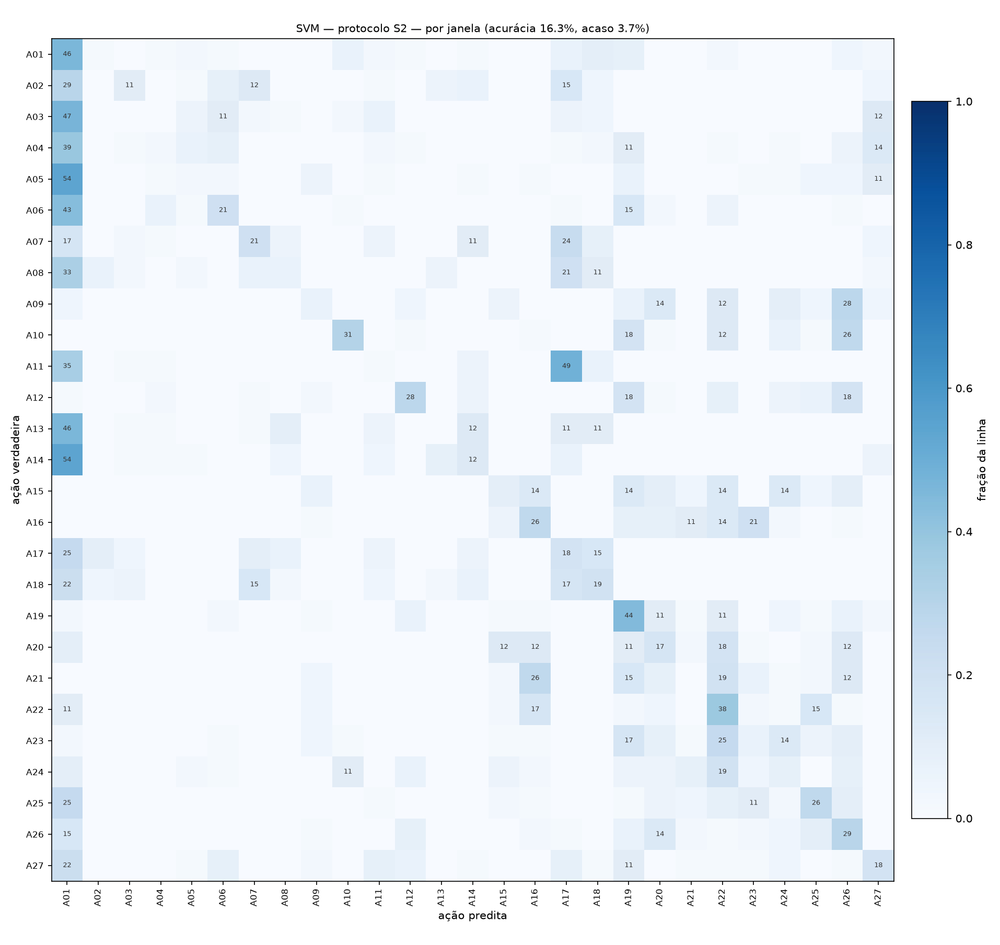

# Resumo do projeto — onde estamos e para onde vamos

**Atualizado em:** 20/10/2026

Um resumo direto do trabalho, para quem chegou agora ou quer se situar. Os
detalhes técnicos estão nos outros documentos de `docs/`.

---

## 1. A ideia do trabalho

O sinal de WiFi atravessa a sala e bate nas paredes, nos móveis **e nas
pessoas**. Quando alguém se mexe, o sinal que chega ao receptor muda um pouco.

A pergunta é: **dá para descobrir o que a pessoa está fazendo só olhando essas
mudanças no sinal, sem câmera?**

É parecido com um morcego, que não enxerga mas sabe onde as coisas estão pelo
eco. Aqui o "eco" é o WiFi. A vantagem sobre uma câmera é a privacidade: ninguém
é filmado.

---

## 2. O que o professor pede

São cinco tarefas, conforme o `tema.pdf`:

| | Tarefa | Em palavras simples |
|---|---|---|
| **a** | Revisão bibliográfica | Ler os dois artigos (Wi-Pose e Winect) e explicar o que cada um fez |
| **b** | Manipular os dados | Abrir os arquivos do sinal e fazer gráficos |
| **c** | Classificar movimentos | Um programa que olha o sinal e diz qual ação a pessoa está fazendo |
| **d** | Limpar o sinal | O sinal vem com ruído e distorção; tirar essa sujeira |
| **e** | Análise crítica | Mostrar onde o programa erra e explicar por quê |

O enunciado pede um modelo **simples** — não exige nada sofisticado.

---

## 3. O que já foi feito

### Troca de dataset

O dataset indicado no enunciado (Wi-Pose) era incompleto: não trazia a **fase**
do sinal, só a amplitude, e as poses eram 2D. Trocamos para o **MM-Fi**:
**40 pessoas** fazendo **27 ações** (agachar, chutar, acenar, pular…) em
**4 salas diferentes**, gravadas com WiFi e com a pose 3D de referência. O
professor já está ciente da troca. O porquê completo está em
[`analise-mmfi.md`](analise-mmfi.md).

### Tarefa (b) — dados e gráficos ✅

Código que abre os dados do MM-Fi e desenha o sinal e o esqueleto 3D
(`src/mmfi.py`, `scripts/inspecionar_mmfi.py`). Também existe uma **versão
leve** do dataset (6 GB em vez de 16 GB), com um verificador de integridade.

### Tarefa (d) — limpeza do sinal 🟡

Primeira técnica implementada: **sanitização da fase**, que remove uma
distorção em forma de rampa que o próprio equipamento introduz no sinal.

### Tarefa (c) — primeiro classificador ✅

O primeiro "adivinhador" de ações:

1. Corta cada gravação em **pedaços de 3 segundos**.
2. Resume cada pedaço em números: para cada antena e cada frequência, a
   **média** do sinal (como a sala é) e o **quanto ele variou** (quanto o
   corpo mexeu no sinal).
3. Um modelo simples (**Random Forest** ou **SVM**) aprende a ligar esses
   números a uma das 27 ações.

**O teste foi feito do jeito honesto:** com pessoas que o modelo nunca viu no
treino, e sem nunca deixar pedaços da mesma gravação dos dois lados (isso faria
o modelo "colar" e inflaria a nota).

### Resultado

Chutando no escuro, a chance de acertar entre 27 ações é **3,7%** (1 em 27).

| Modelo | Pessoas novas no teste (S2) | Pessoas conhecidas (S1) |
|---|---|---|
| Random Forest | **14,5%** | 5,2% |
| SVM | **16,3%** | 6,4% |

*Acerto por pedaço de 3 s. Por gravação inteira, o SVM chega a 17,6% no S2.*

O modelo acerta **cerca de 4 vezes mais que o chute** com pessoas que nunca
viu. Parece pouco, mas é um começo honesto — e nem os autores do MM-Fi
publicaram esse número, então não há "nota certa" para comparar.

### A descoberta curiosa (vai para a tarefa e)

Com pessoas **conhecidas** (S1) o modelo foi **pior**, quase no chute. Por quê?

O modelo aprendeu a reconhecer **quem** está na sala (acerta a pessoa 78% das
vezes) melhor do que **o que** ela está fazendo. Cada corpo deixa uma
"assinatura" no sinal. No S1, o raciocínio dele vira: *"esse sinal parece do
Fulano; já vi o Fulano agachando, então é agachamento"* — mas a ação certa é
justamente uma que ele nunca viu o Fulano fazer. Com pessoas novas (S2) ele não
conhece ninguém e é obrigado a olhar o movimento.

Isso não é erro do código: é um achado real sobre o sinal de WiFi, e é
exatamente o tipo de coisa que a tarefa (e) pede para explicar.

As matrizes de confusão (quais ações o modelo confunde com quais) estão em
`artifacts/figuras/confusao_*.png`. Exemplo — SVM com pessoas novas:



Linhas = ação certa, colunas = palpite do modelo. Quanto mais escura a
diagonal, mais ele acerta. Repare na coluna **A01** ("alongar e relaxar"):
muitas ações são confundidas com ela.

---

## 4. O que falta fazer

1. **Tirar a "assinatura" da pessoa do sinal** antes de treinar (normalizar
   cada gravação), para o modelo prestar atenção no movimento e não em quem é.
2. **Rede neural** — um modelo mais esperto, inspirado no artigo do Wi-Pose
   (camadas convolucionais + recorrentes), comparado contra o classificador
   simples acima. Cabe num notebook sem GPU se for enxuta.
3. **Terminar a análise (e):** quais ações se confundem (ex.: chutar com a
   perna esquerda × direita), se a fase limpa ajuda, quais antenas e
   frequências atrapalham.
4. **Terminar a tarefa (d):** comparar técnicas de limpeza do sinal.
5. **Escrever a revisão dos artigos (a).**
6. **Juntar tudo no relatório.**

**Em uma frase:** o trabalho é ensinar o computador a "ver" movimentos pelo
WiFi; já temos um primeiro modelo funcionando, 4 vezes melhor que o chute, e
agora vamos melhorá-lo com a rede neural e explicar os erros.

---

## 5. Como rodar o classificador

Com o ambiente e o dataset configurados (ver o [README](../README.md)):

```
.venv/Scripts/python.exe scripts/treinar_baseline.py --protocolo s2 --modelo rf
```

<sub>Linux/macOS: `.venv/bin/python` no lugar de `.venv/Scripts/python.exe`.</sub>

Na primeira vez ele monta uma base consolidada em `artifacts/cache/` (~3–4 min,
~8 GB em disco). Depois, cada treino leva de **1 a 3 minutos** num notebook
comum, sem GPU. As figuras saem em `artifacts/figuras/` e os números completos
em `artifacts/resultados/`.
